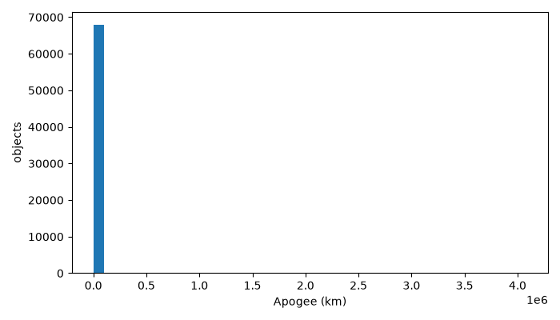
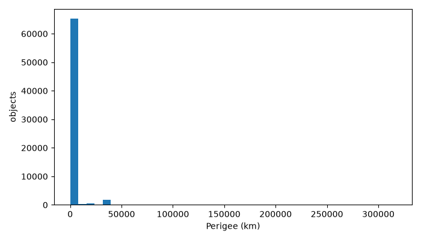
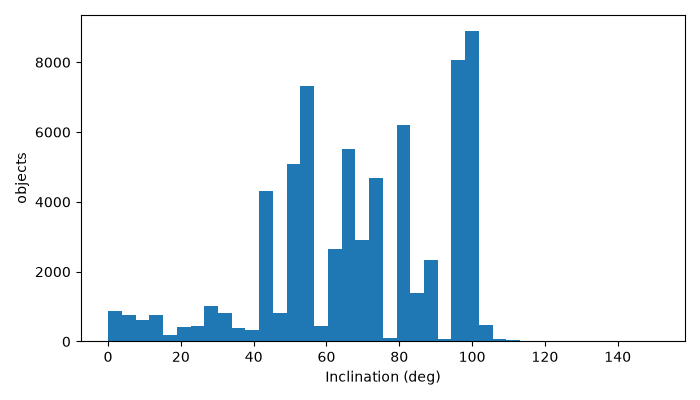
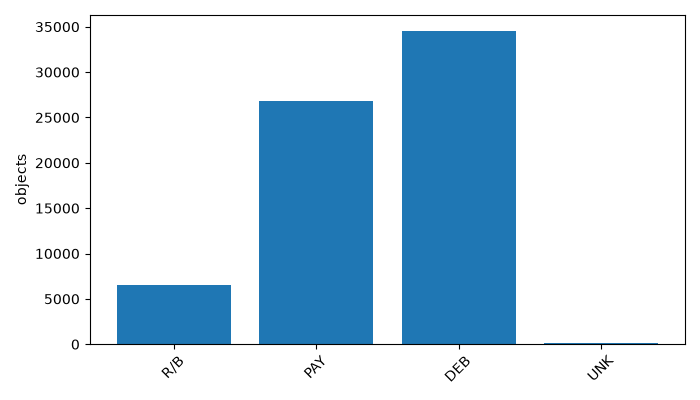

# Space Debris Collision Risk Analytics

## Review 3 Project Report

**Course:** 23CSE352 – Big Data Analytics  
**Review:** Project Review 3 – Apache Spark  
**Team member:** Kireeti - CB.SC.U4CSE23057  
**Additional team members/register numbers:** [TO SUPPLY, if applicable]  
**Department:** [TO SUPPLY: department name]  
**Institution:** Amrita Vishwa Vidyapeetham  
**Faculty guide:** [TO SUPPLY: guide name]  
**Submission workspace:** `C:\space-debris-collision-risk-output\project`

> This report is based only on the Review 3 instructions and observed project evidence. The PySpark model reported here predicts SATCAT `OBJECT_TYPE`; it is not a collision-risk classifier, collision probability model, or conjunction-outcome model.

## 1. Introduction

Space debris analytics combines catalog ingestion, orbital-feature processing, propagation, and close-approach screening. The project demonstrates a bounded local-first workflow using a real SATCAT catalog, a CelesTrak TLE sample, Scala/Spark RDD processing, PySpark ML, Python visualizations, and a web-facing results layer. The implementation intentionally distinguishes screening candidates from confirmed collisions and from calibrated risk probabilities.

## 2. Problem Statement

Large orbital catalogs contain heterogeneous objects, incomplete metadata, and orbital attributes that require validation before analysis. A practical system must process real records, expose useful orbital summaries, identify bounded close-approach candidates, and evaluate a reproducible machine-learning task without inventing collision labels. Review 3 evaluates the Spark RDD concepts, PySpark modelling workflow, visualization, and communication of results.

## 3. Objectives

1. Ingest and validate a real-world SATCAT orbital catalog.
2. Demonstrate Scala/Spark RDD transformations, actions, key/value operations, partitions, lineage, DAG structure, persistence, and fault-tolerance reasoning.
3. Prepare real catalog features and evaluate a reproducible PySpark model.
4. Produce meaningful charts and communicate the workflow, results, and limitations.

## 4. Dataset Description

The primary catalog is the cleaned SATCAT file recorded in `data\satcat_clean.json` and represented analytically by `data\satcat_clean.parquet`. It contains 68,129 records and fields including object name, object ID, NORAD catalog ID, object type, owner, launch/decay dates, period, inclination, apogee, perigee, radar cross-section, orbit center, and orbit type. The source is the original project SATCAT file at `D:\Projects\space-debris-collision-risk\data\raw\satcat_clean.csv`; it was read for bounded processing but not modified.

The object-type counts from the actual EDA run are:

| Object type | Records |
|---|---:|
| DEB | 34,568 |
| PAY | 26,830 |
| R/B | 6,571 |
| UNK | 160 |

The approximately 6 GB joined TLE/SATCAT input remains preserved on D: and was not used in the bounded Spark demonstration. The separate TLE screening uses 60 real Starlink TLEs downloaded from the recorded CelesTrak URL, seven UTC epochs, and a ten-minute step.

## 5. Methodology and Workflow

```text
Real SATCAT catalog
        ↓
Validation and Parquet representation
        ↓
Scala/Spark RDD parsing, filtering, aggregation, lineage and persistence
        ↓
PySpark feature preparation and train/test split
        ↓
PySpark logistic regression for OBJECT_TYPE
        ↓
Held-out evaluation and baseline comparison
        ↓
Python EDA charts and bounded SGP4 candidate screening
        ↓
API/frontend evidence and documented limitations
```

The SGP4 screening is a separate bounded orbital demonstration. It uses TEME coordinates, kilometres for distance, km/s for relative velocity, a 50 km inclusive threshold, and preserved source TLE lines. Its output is a candidate close approach, not a collision or a probability.

## 6. Scala + Spark RDD Implementation

The RDD implementation is in `C:\space-debris-collision-risk-output\phase-2b\spark-rdd\src\main\scala\org\course\spacedebris\rdd\RddDemo.scala`. A 100-row sample was exported from the real cleaned SATCAT Parquet artifact to `real_satcat_sample.csv` for a bounded real-data run. The original deterministic fixture remains preserved separately.

### RDD creation and transformations

The job creates an RDD using `SparkContext.textFile`, repartitions it, parses CSV records, expands parsed options with `flatMap`, and filters records to an altitude range of 200–2,000 km. The meaningful transformations are:

- `repartition` to control the requested partition count;
- `map(parseLine)` for validation and record construction;
- `flatMap` to remove invalid parse results and expand aliases;
- `filter` for the orbital altitude range;
- `reduceByKey` and `sortByKey` for category aggregation and deterministic ordering;
- `distinct` and `sortBy` for alias analysis.

### Actions and key/value operations

The job performs `count`, `collect`, `take`, and `reduce`. Category records are converted to `(category, 1)` pairs and aggregated using `reduceByKey`; the result is collected and sorted by key.

### Actual real-data run

Command:

```powershell
$module = 'C:\space-debris-collision-risk-output\phase-2b\spark-rdd'
$env:JAVA_HOME = 'C:\space-debris-collision-risk-output\tools\jdk-17.0.20.1+1'
$env:MAVEN_OPTS = '--add-exports=java.base/sun.nio.ch=ALL-UNNAMED --add-exports=java.base/sun.security.action=ALL-UNNAMED --add-opens=java.base/java.nio=ALL-UNNAMED --add-opens=java.base/java.lang.invoke=ALL-UNNAMED --add-opens=java.base/java.util=ALL-UNNAMED'
mvn -f "$module\pom.xml" compile exec:java "-Dexec.mainClass=org.course.spacedebris.rdd.RddDemo" "-Dexec.args=$module\src\main\resources\real_satcat_sample.csv 2" "-Dexec.cleanupDaemonThreads=false"
```

Observed output is preserved in `reports\scala-rdd-real-satcat-sample-20261015.log`:

- 100 input records; 66 records passed the altitude filter.
- Two partitions before and after repartition.
- Category counts: DEB 23, PAY 31, R/B 12.
- Total filtered altitude: 36,173.5 km.
- Actual `toDebugString` lineage includes HadoopRDD, textFile, repartition shuffle, map, flatMap, filter, and cached partitions.

### Partitions, lineage, DAG, persistence, and fault tolerance

The job reports two partitions. The actual lineage is preserved in the real-data log and the deterministic fixture log. The printed DAG explanation connects the source, repartition, parsing, filtering, cache, category branch, alias branch, and altitude reduction. `valid.cache()` is followed by a count before and after caching; the lineage reports cached partitions.

The disposable fault fixture is separate from the real catalog and uses eight in-memory integers. Its preserved log shows partition 0 failing at attempt 0, succeeding at attempt 1, and recovered total 36 matching the independent baseline. This demonstrates local task retry/recomputation from lineage only; it does not demonstrate machine, executor, or production failure recovery.

Evidence:

- `submission\evidence\scala-rdd-output.log`
- `submission\evidence\scala-rdd-real-satcat-sample-20261015.log`
- `submission\evidence\fault-tolerance.log`
- `phase-2b\spark-rdd\src\main\scala\org\course\spacedebris\rdd\RddDemo.scala`

## 7. PySpark Machine Learning

The PySpark model is implemented in `scripts\pyspark_ml_object_type.py` and executed in the isolated WSL2 runtime with Spark/PySpark 3.5.1, Java 11.0.32, and Python 3.12.3.

### Feature preparation

The model uses five numeric orbital/catalog features: `PERIOD`, `INCLINATION`, `APOGEE`, `PERIGEE`, and `RCS`. Median imputation is fitted on the training data, followed by vector assembly and training-fitted label indexing. Identifiers and the target are excluded from the feature vector.

### Split, model, and evaluation

The reproducible split uses seed 42 with 51,027 training rows and 17,102 test rows. The model is logistic regression evaluated on held-out data. Actual results from `data\pyspark_ml_validation_20261015\metrics.json`:

| Metric | Result |
|---|---:|
| Accuracy | 0.663899 |
| Macro-F1 | 0.627583 |
| Majority baseline accuracy | 0.511753 |
| Majority baseline macro-F1 | 0.169258 |

Class-level F1 values are DEB 0.754435, PAY 0.610807, R/B 0.038328, and UNK 0.000000. Model reload prediction equivalence is recorded as true.

The target is SATCAT `OBJECT_TYPE` classification. It is not collision risk, conjunction outcome, collision probability, or a validated orbital-risk model. The separate candidate prioritization heuristic uses miss distance and relative velocity and is not used as a training label.

## 8. Visualization

Four genuine charts were generated from the 68,129-row SATCAT processing run:









The chart metadata and missing-value counts are in `reports\eda\eda.json`. The charts are actual outputs, not illustrative placeholders.

## 9. Results and Discussion

The real SATCAT catalog was loaded with 68,129 rows and zero rejected rows in the bounded ingestion run. The RDD sample demonstrates the required Spark mechanics on records derived from the real catalog. The PySpark model performs better than the majority baseline for the selected object-type task, but the very low R/B and UNK recall shows that the model is not uniformly reliable across classes.

The bounded SGP4 screen found one Starlink candidate at 19.837271672 km separation and 0.216007095 km/s relative velocity at 2026-10-14T05:50:00Z. The shell implementation matched the brute-force reference on bounded fixtures and uses a streaming epoch API, but the candidate is only a screening result. No independent historical conjunction labels were available for supervised collision-risk modelling.

## 10. Conclusion and Future Work

Review 3 requirements are demonstrated for RDD concepts, PySpark preprocessing/splitting/model/evaluation, and visualization. The real-data RDD run closes the earlier gap of relying only on a synthetic fixture, while remaining bounded and safe. Future work requiring additional inputs includes uncertainty-aware conjunction assessment, independent historical CDM/orbit validation, and any collision-risk model with defensible labels. Those tasks are not claimed complete here.

## 11. References

1. CelesTrak Starlink TLE source recorded in `data\screening.json`.
2. NASA NTRS, *Iridium 33 / Cosmos 2251 Collision Event Summary*, preserved at `reports\historical-sources\nasa-iridium-cosmos-event-summary.pdf`.
3. Apache Spark documentation and the project-local Scala/PySpark source and logs.
4. SATCAT source and provenance recorded in `data\satcat_clean.json` and `reports\pipeline-final.log`.

## 12. Evidence and Reproducibility

The final audit is `reports\review3-final-submission-audit.md`. Regression commands and outcomes are preserved under `reports\` and `submission\evidence\`. The original D: dataset and pre-existing Git changes were preserved.
